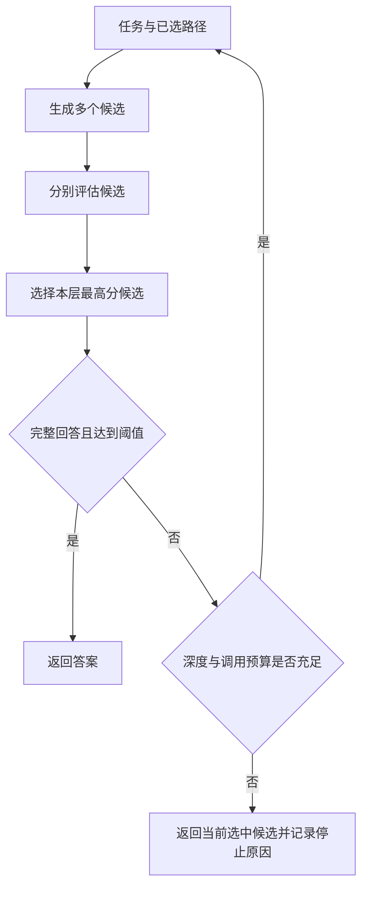
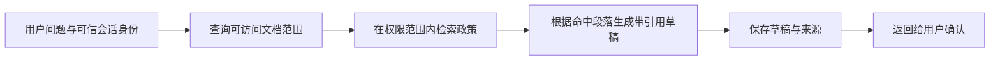
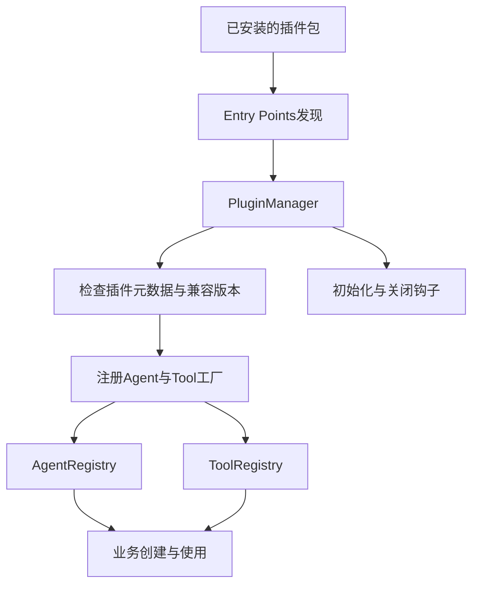

# Task3｜第七章：构建自己的Agent框架

学习日期：2026年11月19日  
学习内容：第七章《构建你的Agent框架》  
学习任务：Task3  
实践版本：`hello-agents==0.1.1`

这一章让我更关注代码之间的边界。第四章可以把一个智能体写成独立脚本，但当模型、工具、历史记录和执行策略都需要替换时，怎样避免改一个地方就牵动整套代码，就成了框架需要解决的问题。

我不觉得自建框架一定比现有框架好。学习时自己实现一遍，可以看清楚机制；做应用时，则要考虑维护成本。对我来说，更值得学的是哪些地方需要统一接口，哪些地方还不该急着抽象。

下面按章末6道习题整理。第2、4题配有可运行代码，位置见[practice.py](practice.py)与[test_practice.py](test_practice.py)。

## 习题1：为什么自建框架，怎样控制抽象的边界

### 1. 四个局限怎样影响开发效率

本次没有可引用的第六章真实项目实验记录，所以我以教材提到的LangChain类框架为例，分析可能遇到的问题，不把它们写成自己已经发生过的项目经历。这些也是框架选型时需要验证的风险，不代表每个框架、每个版本都一定如此。

| 教材提出的问题 | 对开发的影响 | 我的应对思路 |
| --- | --- | --- |
| 过度抽象 | 为了实现一次模型调用，需要先理解多层对象和配置；报错时难判断是哪层出了问题 | 从最小调用链开始，只有出现重复需求才增加封装 |
| 接口快速变化 | 升级后导入路径、参数或行为改变，旧示例难以复现 | 固定依赖版本，升级前用接口测试和样例任务回归 |
| 内部机制不透明 | 工具没调用、历史没传入时，需要跨多层代码排查 | 保留消息、工具输入输出和停止原因，能够追踪完整执行流程 |
| 依赖关系复杂 | 与项目已有依赖冲突，环境安装和部署成本增加 | 使用隔离环境，按需引入组件，区分直接依赖与可选依赖 |

自建框架能把这些边界控制在自己手里，但也意味着自己负责重试、并发、兼容性和测试。如果只是完成一个固定流程，直接使用现成框架或普通函数，可能更省事。

### 2. “万物皆为工具”的优势和局限

优势是调用方式统一。搜索、知识检索和记忆读取，都可以注册成有名称、描述和参数的工具。新增能力时，Agent不必为每种模块增加一种分支；工具也更容易单独测试、记录耗时和做权限检查。

但统一的是入口，不代表所有能力都没有区别。检索通常是只读操作，写入长期记忆会改变状态；MCP是连接外部能力的协议，底层还有连接建立、认证和资源释放。若都只剩一个`execute()`，这些重要差异很容易被藏起来。

例如用户说“记住我喜欢简洁回答”，可以通过记忆写入工具处理；但会话结束后的必要归档，不应完全依赖模型想不想调用工具。我的做法是保留统一调用入口，同时在工具元数据里标记读写性质、权限和是否需要幂等；必须执行的生命周期逻辑仍由框架控制。

### 3. 与第四章相比，框架化具体改进了什么

- **模型调用集中管理。** 不同Agent依赖同一个LLM接口，换供应商时不必逐个修改执行循环。
- **消息与历史统一。** 用`Message`表示角色、内容与元信息，避免每个脚本维护不同格式。
- **工具与执行策略分离。** Agent负责决定下一步，注册表负责查找和执行工具。
- **配置与提示词可以替换。** 任务变化时，更多调整集中在配置或子类里，不必复制整份脚本。

如果由我设计，优先级是接口小而稳定、状态归属清楚、依赖可以替换、错误能定位、有明确停止条件。统一并不是把所有东西塞进基类，只有多个实现真正共享的行为才值得放进去。

## 习题2：多供应商支持与本地推理

### 1. 用继承方式添加Gemini

我选择通过Gemini的兼容接口扩展`HelloAgentsLLM`。这样可以继承原有`invoke()`和`think()`，只增加供应商选择与配置逻辑。[Google官方兼容接口文档](https://ai.google.dev/gemini-api/docs/openai)

实现见[GeminiLLM](practice.py)。规则是：显式`provider`优先；默认模式下发现`GEMINI_API_KEY`则选择Gemini；没有该变量时交回父类自动检测。Gemini与其他供应商密钥同时存在时，这个子类会优先选Gemini；希望避免歧义时应明确传入供应商。

配置示例：

```text
GEMINI_API_KEY=你的密钥
GEMINI_MODEL_ID=你的账号当前可用的模型ID
```

```python
from practice import GeminiLLM

llm = GeminiLLM()  # 在此之前加载环境变量
answer = llm.invoke([{"role": "user", "content": "解释工具注册表的作用"}])
```

代码要求显式配置模型ID，没有把某个可能过期的模型名当默认值。它向父类传入明确的密钥和Gemini服务地址，再标记`provider="gemini"`，避免通用`LLM_BASE_URL`意外覆盖目标端点。调用者显式传入`base_url`时，则需要自行确认它是可信的兼容服务。

本次用真实父类与模拟客户端验证了环境变量选择、参数覆盖和缺失配置报错；没有使用真实密钥发起Gemini请求，也没有验证所有供应商专有能力都兼容。

### 2. 同时设置OPENAI_API_KEY与本地URL会怎样

按7.2.3节展示的检测代码，如果只设置题目给出的两个变量，特定供应商密钥的检查早于URL判断，因此供应商会被识别为`openai`。

但这不代表请求一定发到云端。正文的`_resolve_credentials()`仍然允许`LLM_BASE_URL`覆盖默认地址，因此可能形成：

```text
provider = openai
base_url = http://localhost:11434/v1
api_key = OPENAI_API_KEY中的值
```

也就是说，供应商标签、实际请求地址与认证信息是三件不同的事。仅看日志中的`openai`，不足以判断请求去了哪里。

我在安装包0.1.1上也做了离线检测测试，结果同样是`openai`。另外发现该版本实现的顺序是“特定供应商环境变量→密钥格式→URL”，与正文写的后三项顺序不同。这次题目的结论不受影响，但分析其他组合时需要看实际版本代码。

这种自动推断方便单一配置的使用者，但多供应商共存时不够直观。我更倾向：显式供应商最优先；没有显式配置时检测冲突，要求澄清，而不是悄悄组合互不匹配的地址和凭据。也不应把真实云端密钥随意发给一个只是看起来兼容的地址。

### 3. vLLM、SGLang和Ollama对比

SGLang是面向大语言模型与多模态模型的推理服务框架，官方强调RadixAttention、前缀缓存与多GPU并行等能力，也提供兼容API。它和vLLM更偏向推理服务，Ollama则更强调本地模型的管理与运行体验。[SGLang文档](https://docs.sglang.ai/)、[vLLM文档](https://docs.vllm.ai/en/stable/)、[Ollama文档](https://docs.ollama.com/faq)

| 维度 | vLLM | SGLang | Ollama |
| --- | --- | --- | --- |
| 易用性 | 熟悉Python、GPU环境和模型部署后较容易接入服务 | 需要理解运行环境、模型支持与服务参数 | 适合个人机器快速下载和运行模型，入门步骤较少 |
| 资源占用 | 与权重精度、KV缓存、上下文和并发有关；偏服务端容量规划 | 同样需要规划显存，前缀复用收益依赖实际请求分布 | 可选择较小或量化模型，CPU/GPU加载方式会影响内存与速度 |
| 推理速度 | 连续批处理、缓存等机制适合服务吞吐优化 | 共享前缀和结构化工作负载等场景值得评测 | 单人交互方便，不能由此推出所有场景都更快或更慢 |
| 推理精度 | 取决于具体模型、精度和推理设置 | 同左，框架本身不等于更高答案正确率 | 量化方案、模型版本与模板差异需要单独核对 |
| 我会优先验证的场景 | 多用户API服务与批量推理 | 大量共享前缀、多分支或复杂生成请求 | 本地学习、个人原型和轻量体验 |

不应把PagedAttention等特定实现统称为所有工具都采用的同一技术。速度也没有脱离条件的固定排名：应该固定模型权重、量化精度、硬件、输入输出长度和并发，再比较首Token延迟、输出速度、吞吐和显存峰值。本次完成了资料对比，没有进行三套推理服务的实测。

## 习题3：Message、Agent和Config

### 1. Message使用Pydantic的优势

`BaseModel`让消息在进入系统时就检查字段，而不必等到模型请求失败才发现角色拼写错误。它还提供结构化序列化和Schema能力，便于日志、存储以及接口约束。[Pydantic模型文档](https://docs.pydantic.dev/latest/concepts/models/)

例如`role`被限制为`user/assistant/system/tool`后，`role="usr"`会验证失败。不过，类型合法不代表内容正确；Pydantic默认也可能进行类型转换，严格场景应配置对应校验。

正文的`Message.to_dict()`只输出角色和内容，不能直接代表完整的工具调用协议；真实工具交互可能还需要工具调用ID等关联字段。时间戳与`metadata`则应当保存在内部消息中，避免转换给模型时丢失审计信息。

### 2. run与_execute是什么模式

如果基类用公开的`run()`统一执行校验、日志、状态管理，再调用子类实现的`_execute()`，这属于**模板方法模式**：基类固定流程骨架，子类补充具体算法。

```python
class Agent:
    def run(self, input_text):
        self.validate(input_text)
        result = self._execute(input_text)
        self.record_result(result)
        return result
```

上面只说明模式，不是配套代码。好处是各子类共享入口行为，不容易漏掉校验或日志。

但本文件7.3.3节实际展示的是抽象`run()`，没有`_execute()`；安装包0.1.1也是如此。因此当前代码更准确地说是“抽象基类＋多态”，不能把题干描述的模板方法当成已经实现的事实。我的ToT扩展也按真实接口重写`run()`。

### 3. 配置为什么可能使用单例，是否必须

单例模式限制一个进程中某个类只有一个实例。配置使用单例，可以减少重复读取，让各组件共享同一份配置。但它不是配置管理的必要条件，更不能保证跨进程只有一份配置。

正文的`Config`只是一个`BaseModel`，`from_env()`每次构造新对象；没有缓存或控制实例创建的实现。离线测试中`Config() is Config()`为假，所以本章示例实际上没有实现单例。

不用单例也未必有问题。如果所有组件都由入口接收同一个配置对象，同样可以保持一致。真正容易出错的是各组件自行读取环境、各自修改配置，却没有明确的优先级。

我更倾向在启动时创建配置，再通过构造函数传入。不同Agent需要不同模型或测试参数时比较清楚，也减少全局可变单例导致的测试互相影响。对于必须共享的配置，可以集中提供不可变快照，而不是允许任何模块随时修改。

## 习题4：框架化ReAct、质量评分与Tree-of-Thought

### 1. ReAct的3个具体改进

| 改进 | 对应代码组织 | 对维护和扩展的帮助 |
| --- | --- | --- |
| 使用统一Agent入口与消息管理 | `Agent`、`Message`与历史方法 | 不同范式可用相同的调用方式，外围组件不必识别具体Agent类型 |
| 工具通过注册表查找执行 | `ToolRegistry` | 添加工具无需改ReAct循环，工具可以独立测试和替换 |
| 提示词与执行上限可配置 | 自定义模板、`max_steps`与配置对象 | 调整任务策略时不必复制整个Agent类 |

这些是组织方式的改进，不代表所有问题已经解决。教材的ReAct示例仍依赖文本格式与正则；若要提高稳定性，还可以沿用第四章练习里的JSON动作和参数校验。框架也不能自动保证循环会选对工具。

### 2. 为Reflection增加评分

实现见[ScoredReflectionAgent](practice.py)，它继承真实的`ReflectionAgent`。每次评审返回：

```json
{"score":72,"feedback":"遗漏了边界情况","complete":false}
```

控制流程：生成初稿→评审打分→低于阈值时按反馈修订→再次评审。默认阈值85分、最多修订2次。初稿和最后一次修订都要评审，达到阈值则提前结束；预算用完则保留评分最高的版本。

我补了几个边界：评分必须是0—100的有限数值；拒绝NaN和把`true`当分数的情况；高分但`complete=false`视为评审冲突，停止并记录原因，不当成成功；非法JSON直接报告错误，避免把格式失败误认为质量通过。

这里采用固定评审标准，比较每个版本。分数仍是模型判断，不是客观证明；代码任务应加真实测试，事实性回答应核查来源。保存的“最佳版本”只是本次评分规则下最高的一版。

```python
from practice import ScoredReflectionAgent

agent = ScoredReflectionAgent("reviewer", llm, threshold=85, max_revisions=2)
answer = agent.run("写一个说明清楚且处理边界条件的函数")
print(agent.stop_reason)
```

此扩展是最小单任务实现：保存本次评审记录与用户/最终答案，不使用旧对话作为新任务输入，也不复现父类所有提示词定制功能。

### 3. 实现Tree-of-Thought Agent

实现见[TreeOfThoughtAgent](practice.py)，基类从`hello_agents.core.agent`导入，0.1.1顶层没有导出`Agent`。

每层先生成2—3个不同候选，再逐个评分，选最高分候选继续下一层。记录候选、深度和评分；达到完整答案阈值、深度上限或模型调用预算时结束。候选这里只是阶段方案或答案，不要求模型公开完整内部推理。



这是满足题目“多路径生成、选最好路径继续”的最小版本，属于宽度为1的贪心搜索，不包含全树回溯或宽度更大的beam search。模型评分也未必能找出全局最优路径。[ToT论文](https://arxiv.org/abs/2305.10601)中的搜索思路更完整，不能把这份小实现当成论文结果复现。

设深度上限为D、每层候选数为B，完整搜索一层需要1次生成和B次评分，总调用量约为`D × (1+B)`。默认D=3、B=3，因此最多约12次正常调用，另有独立的总调用上限。相比只走一条路径，这种做法增加了候选比较的机会，也增加了成本。

## 习题5：工具接口、工具链与并行执行

### 1. 为什么统一接口，多返回值怎么处理

统一接口让注册表不必针对每种工具写一种调用方式，也方便集中做参数校验、日志、超时和权限检查。它保证的是调用约定，不是每个工具的业务行为都相同。

题干说`BaseTool.execute()`，但正文7.5.1展示的是`Tool.run(parameters)`与`get_parameters()`。核心原则一致，接入代码时应遵循实际版本名称。

搜索结果有多个字段时，不宜拼成一个难以解析的句子，可以返回结构化结果。如果当前接口要求字符串，则用JSON序列化：

```json
{
  "ok": true,
  "data": [
    {"title": "资料标题", "summary": "相关内容摘要", "url": "https://example.com/source"}
  ],
  "error": null
}
```

下游解析后按字段取值。失败同样返回明确结构，避免工具链把一段错误文字当成正常数据继续处理。

### 2. 至少3个工具串联的场景

我选择“根据已批准的内部政策回复员工问题”，串联身份与权限查询、政策检索、草稿生成和草稿保存四个工具：



第二个工具必须接收第一个工具返回的权限范围，不能让模型任意填用户身份。检索无结果时请求补充信息，不继续编造政策；保存失败时只重试保存步骤。链中传递的是结构化结果，而不是让计算器之类只接受表达式的工具接收一大段自然语言。

正文`ToolChain`按模板字符串拼接输入，如果前一工具报错却仍返回字符串，就可能继续执行下一步。扩展时需要检查`ok`状态、必需字段和空链情况，并区分读操作与有副作用的操作。

### 3. 线程池在什么情况下有帮助

互相独立的I/O密集任务适合并行，例如同时查询不同资料源。串行耗时接近各步骤耗时之和；并行后更接近最慢的一项，再加调度和汇总开销。但前后有依赖的工具链不能直接全部并行。

对于普通CPython中占用解释器执行的CPU密集代码，线程池通常不能带来理想的多核加速；释放GIL的本地库是另一种情况。任务很短时，线程调度的开销也可能大于收益。

工程上还要限制并发、检查工具是否线程安全、处理接口限流和单项失败。请求超时或取消等待，不代表线程里已经执行的远程动作被撤销；线程池要显式关闭，不应只依赖析构函数回收。[Python并发执行文档](https://docs.python.org/3/library/concurrent.futures.html)

## 习题6：流式输出、对话树和插件系统

### 1. 流式输出的实现方案

检查0.1.1后发现，LLM层已经有`think()`与`stream_invoke()`，`SimpleAgent`也已有`stream_run()`。因此“添加流式输出”不应写成框架完全没有流式能力，而应是为各类Agent统一流式事件约定。

我会保持`run()`返回完整字符串，增加`stream_run()`逐条返回事件：

```text
StreamEvent(type, run_id, content, metadata)
type: text_delta / tool_start / tool_end / final / error
```

需要关注的修改点：

1. **LLM适配层：** 统一返回文本片段，过滤没有文本的事件；异常向上层传递。
2. **Agent层：** 规定流式事件格式；SimpleAgent可直接输出文本片段，ReAct要等待工具参数完整并校验后再执行。
3. **Message与历史：** 生成中先缓存在当前运行，完成后存一次完整消息；取消或失败保留中断状态，不能伪装成正常结束。
4. **展示层：** 根据事件类型更新文本或工具状态，避免底层打印一次、界面再显示一次造成重复。

Reflection通常有多个候选版本，不应把每个初稿都直接冒充最终答案推给用户。可以展示“评审中”的状态，再输出选定结果。流式也不等于暴露全部内部推理。

### 2. 多轮对话、分支与回溯

我会把历史从一条可变列表扩展成消息树：每条消息有`message_id`、`parent_id`和`conversation_id`，不同分支可以共享之前的祖先消息。

| 组件 | 职责 |
| --- | --- |
| ConversationStore | 保存消息节点、父子关系、运行状态与版本 |
| ConversationManager | 创建会话、追加消息、分支和移动当前游标 |
| ContextBuilder | 从当前节点沿祖先链构造模型上下文，处理长度预算 |
| Message | 继续承载角色、正文及元信息，扩展节点ID与工具关联信息 |

调用`run()`时由管理器提供会话ID和当前节点，执行完成后追加结果。分支是在旧节点上创建新的子节点，不覆盖原来的回答；回溯只是移动上下文游标，并不会自动撤销已经发送的消息、修改的数据库或执行的工具动作。

较长历史可以摘要，但原始消息仍保留。摘要需要记录覆盖范围，工具调用与工具结果应成组保留，避免只保留半个调用。存储查询也必须按会话归属做权限检查。

### 3. 插件系统架构与关键接口



关键接口可以先保持少量：

```text
PluginManifest: name, version, api_version, permissions
Plugin.register(registry): 注册Agent和工具工厂
Plugin.start(context): 初始化必要资源
Plugin.close(): 关闭连接和线程池
Registry.register_agent(name, factory)
Registry.register_tool(name, factory)
```

第三方包通过Python包元数据的Entry Points声明插件，框架用`importlib.metadata.entry_points()`发现；插件安装到环境后即可被识别，不必修改核心代码。[Python官方文档](https://docs.python.org/3/library/importlib.metadata.html)

管理器检查同名冲突、框架API版本和配置，再按需加载。加载失败应显示插件名和原因，不直接让全部框架启动失败；必要时可关闭单个插件。

需要特别区分发现机制与安全隔离：Entry Points加载的是Python代码，并不是沙箱。仅在清单里写权限并不能阻止插件读文件或联网；不可信插件应放到独立进程或容器，通过受限接口调用。当前练习只设计接口和架构，没有实现完整插件加载器。

## 实践记录与复现

本次用真实的`hello-agents==0.1.1`运行扩展，没有创建一个同名假的`Agent`类来代替框架。模型输出使用预设响应，客户端初始化在测试中被替换，测试不会发送真实模型请求。

测试共13项，覆盖Gemini环境变量选择、显式供应商覆盖、缺失配置、原框架检测优先级、基类与配置行为、评分校验、提前停止、迭代与最佳版本保留、ToT候选选择和预算限制。结果为`Ran 13 tests`、`OK`。

```bash
python -m pip install -r requirements.txt
python -m unittest -v test_practice.py
```

以上命令在本目录执行。当前工作区另有独立的`.chapter7-venv`测试环境，不需要把虚拟环境或密钥一并放进笔记仓库。

真实Gemini联调、三种本地推理服务的性能比较，以及流式事件、会话树和插件系统的完整实现尚未完成。它们在本文中分别作为待验证项或设计方案，不能由这13项测试推导出模型效果提升。

## 学习收获

我这次比较明确的认识是，统一接口是为了让变化停留在局部，而不是为了把所有差异藏起来。供应商名称与请求地址、模型评分与实际正确性、消息回溯与操作撤销，都需要分开考虑。

另外，读题时也不能只按题干往下写。对照正文和实际版本之后，才发现单例、模板方法和工具接口的描述并不完全一致。先确认代码真正做了什么，再讨论怎么扩展，后面的设计会更踏实。

资料来源：第七章教材文件、教材指定的`hello-agents==0.1.1`安装包，以及各题链接的官方文档和ToT论文。查阅日期：2026年11月19日。
