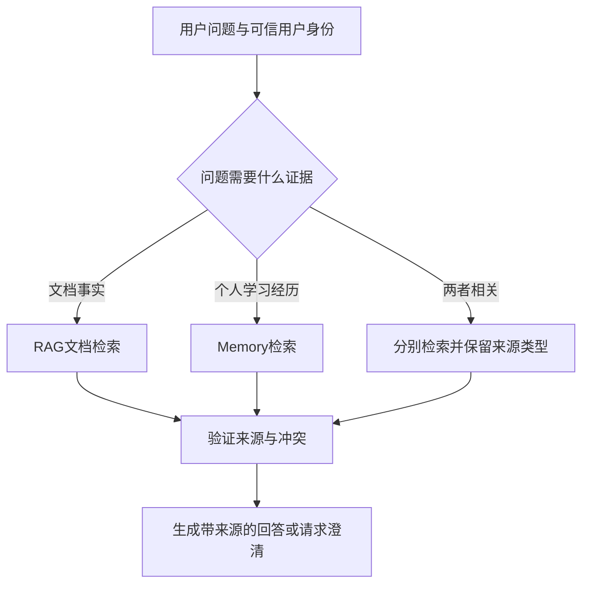

# Task4｜第八章：记忆与检索

学习日期：2026年11月23日  
学习内容：第八章《记忆与检索》

这一章里，我最在意的两个问题是：什么内容值得长期记住，回答问题时又该找哪一类信息。把所有聊天都保存下来不等于有了好记忆，把文档切块放进向量库，也不等于能够准确回答。

下面按章末5道题整理。语义分块与遗忘评分的独立算法见[practice.py](practice.py)，测试见[test_practice.py](test_practice.py)。数据库部署、真实Embedding和模型检索效果没有在这次练习中实测，涉及这些部分时给出方案和验证方法。

## 习题1：四种记忆与长期整合

### 1. 情景记忆和语义记忆的评分

本章情景记忆的评分为：

`(0.8 × 向量相似度 + 0.2 × 时间近因性) × (0.8 + 0.4 × 重要性)`

语义记忆的评分为：

`(0.7 × 向量相似度 + 0.3 × 图相似度) × (0.8 + 0.4 × 重要性)`

情景记忆记录某次具体经历，回答“刚才讨论了什么”“最近做过什么”时，时间很重要。语义记忆偏向概念与事实，回答“这个概念和哪些知识有关”时，实体关系比单纯的新旧更有帮助。

不过，这两组数字是工程设定，不是认知科学证明的固定比例。0.2的近因性与0.3的图得分也不能直接横向比较强弱：它们属于不同公式，还取决于各项分数是否归一化。向量相似度已经占主要权重，关系和时间是在相关内容中作进一步筛选。

### 2. 个人健康管理助手如何组合记忆

| 类型 | 我会保存什么 | 示例与边界 |
| --- | --- | --- |
| 工作记忆 | 当前记录过程中还没确认的信息 | 用户正在补录当天午餐，暂存份量和时间，确认前不当成长期事实 |
| 情景记忆 | 带日期、来源的事件 | 某天的运动时长、睡眠记录和用户描述，保留测量条件与缺失项 |
| 语义记忆 | 经确认的长期偏好及概念关系 | 用户偏好晚间运动；区分本人确认、设备估计和助手推测 |
| 感知记忆 | 有保留价值的原始图片、音频及关联表示 | 饮食照片或记录语音，保留来源，识别结果不直接等同于事实 |

这里讨论系统架构，不根据这些示例提供具体医疗建议。数据使用与保留需要用户知情，不能因为系统能识别图片，就默认长期保存所有原始照片。

### 3. 工作记忆何时转为长期记忆

我会在任务完成、用户明确说“请记住”、同一偏好多次得到确认，或者重要工作记忆即将到期时触发检查。检查不等于立即写入：还要判断是否有长期价值、来源是否可靠、是否允许保存、是否与旧记录冲突。

一个可执行的触发规则是：任务结束或TTL剩余不足10%时扫描；重要性达到0.7，且已确认或在不同会话重复出现；通过敏感信息保留检查后才整合。数字是初始参数，需要调试。

具体事件转为情景记忆，稳定偏好或知识转为语义记忆；通过来源ID去重，保留有效时间与版本。持久化成功后才清理工作副本。失败时重试或标记待处理，不先删后存，也不能在TTL到期后才想起归档。

## 习题2：文档分块与检索策略

### 1. 没有标题时怎样切块

小说可以沿段落、场景或对话轮次切分；条文则应优先保留条、款、项和交叉引用。即使没有Markdown标题，也不应该一律按固定字数硬切。

本次实现的最小算法是：先按句号、问号、感叹号及换行分句，计算相邻句子的Embedding余弦相似度；相似度低于阈值则开始新块，同时设置最大长度。很长的单句使用长度切分兜底，确保输入不会无限增长。

`semantic_chunks(text, embed, threshold=0.55, max_chars=600)`把编码器作为参数传入。实际接入时可以调用本地Sentence Transformer等编码器；测试使用人工指定向量，只验证边界判断、原文不丢失、长度限制与错误输入，不代表已经测出了真实语义分块质量。

这个实现保留原文，但暂未保存字符偏移和加入重叠。正式索引时还需记录文档ID、版本、起止位置和父段落；相邻句相似度也只是边界线索，代词、省略和话题渐变都可能误导它。阈值应按文档类型调，不是越碎越好。

### 2. 技术文档问答中的基础检索、MQE与HyDE

我选择“数据库连接池耗尽时如何排查”作为场景。用户说“服务偶尔卡住”，而文档写的是连接泄漏、连接池上限和等待超时，这种表述差异适合观察查询扩展的作用。

| 方法 | 做法 | 可能的收益 | 代价与风险 |
| --- | --- | --- | --- |
| 基础检索 | 直接编码原问题并检索 | 流程短、成本低，适合术语明确的问题 | 模糊表述可能漏掉关键文档 |
| MQE | 生成多种等价查询，合并去重与排序 | 覆盖不同术语和描述角度 | 增加调用与检索次数，扩展可能偏题 |
| HyDE | 先生成假设回答或文档，再编码检索真实资料 | 让短问题接近文档的表达形式 | 假设内容可能带入错误方向，增加生成开销 |

HyDE中的假设文档不是证据，最终答案仍只能引用实际召回的来源。[HyDE原论文](https://arxiv.org/abs/2212.10496)

对比实验应固定文档版本、分块、Embedding与最终上下文预算。准备带相关文档标注的问题集，分别运行三种方法，记录Recall@k、MRR、引用正确率、回答依据充分性、延迟和费用。MQE合并后的候选不能因为数量更多就直接宣称更好，应按同一最终k值比较。

本次没有真实检索评测数据，因此不能确认哪种方法效果最好，也不沿用教材里未在本次数据集验证的提升百分比。我的初始方案是默认基础检索，对模糊问题尝试MQE，问题与文档措辞差距大时再评估HyDE。

### 3. 三种嵌入方案怎么选

| 方案 | 准确性方面 | 速度与成本 | 离线与维护 |
| --- | --- | --- | --- |
| 百炼API | 取决于所选模型对语言、术语和领域的适配 | 有网络延迟、配额与调用费用，可批量编码 | 需外部服务与凭据，核对数据处理边界 |
| 本地Transformer | 可选择适合领域的稠密编码模型 | 有模型加载及计算成本，批处理可摊薄开销 | 可离线运行，但需维护权重、硬件和环境 |
| TF-IDF | 擅长词项匹配，对同义改写较弱 | 通常便宜、容易建立基线；词表大时也有存储成本 | 易离线部署，不需要生成模型 |

TF-IDF是词法稀疏表示，不应当作与深度Embedding等价的语义模型。我会先做词法基线；确需同义召回时再选稠密模型，也可以融合两路结果。换模型后要重新处理不兼容的索引，不能只改查询端就把不同向量空间混用。

## 习题3：智能遗忘、归档与敏感信息删除

### 1. 综合保留评分

我把评分定义为“越高越应该保留”，避免“遗忘分”和“重要性分”方向混淆：

`S = 0.5I + 0.2F + 0.3R`

- I为0—1的重要性。
- F为`min(1, log(1+访问次数)/log(101))`，对高频访问做压缩。
- R为`2^(-闲置天数/30)`，30天作为示例半衰期。

配套`retention_score()`实现评分，`archive_candidates()`把低分、未固定的记忆列为归档候选，不直接执行删除。固定记录跳过自动淘汰；用户删除请求则是另一条显式流程，不能被“高重要性”阻止。

这里的访问应只统计有效用户检索或使用，避免后台扫描把所有记忆刷成高频。评分权重与半衰期也应按类型调整：历史事件可能很久不用却值得保留，账户偏好则可能需要持续有效。不能让一个总分代替全部保留政策。

### 2. 冷存储归档与恢复


工作记忆先整合有价值的部分，临时残留按TTL处理；情景记忆按时间批次归档；语义记忆归档时保留来源、关系与版本，防止留下无来源的图节点；感知记忆可以把大文件移入冷对象存储，保留受权限控制的引用。

归档清单包括租户、用户、记忆ID、类型、时间、原始来源和校验信息。恢复前检查用户是否已删除该信息；若Embedding模型已经变化，恢复原文后重新编码，不直接混用旧向量。归档转移需要可重试与去重，不能在冷副本写入失败时删除热副本。

### 3. 数据库删除是否足够

不够。原文可能还出现在向量点、图实体及关系、摘要、缓存、文件、日志、归档、备份和第三方请求记录里。删除一个数据库行，只覆盖其中一份。

我会用来源ID追踪派生数据：先阻止继续检索与写回，随后删除或重建相关向量、图关系和摘要，清理缓存与归档，并记录完成状态。共享实体不能简单整节点删除，应去掉该用户来源的断言，重新计算剩余事实。

备份、事务日志和存储介质可能有不同保留期，需说明何时不可访问、何时完成物理清理，并让恢复流程重放删除清单，避免旧备份把数据带回来。只有符合密钥隔离和存储策略的场景才可考虑加密擦除，不能把“删密钥”当作通用保证。

如果信息已经进入模型训练，删除检索库不能证明模型参数也忘记了。实际数据清除应核对各存储与服务的删除机制，本次代码没有声称实现跨系统彻底擦除。

## 习题4：学习助手的路由、报告和多用户隔离

### 1. 什么时候用RAG，什么时候用Memory

“文档中如何定义某概念”优先RAG；“我上次学到哪里”优先Memory；“结合我上次错题解释这份文档”需要两者。我的路由设计会先判断问题涉及的来源和时间，再选检索渠道，而不是每个问题都无差别调用两个工具。



路由不确定时先澄清或做有限的双路检索。个人记忆可帮助调整解释方式，但不能覆盖当前权威文档；同一来源不同版本冲突时，按版本和有效时间核查。对话里出现过一句话，并不代表它已经是可靠知识。

### 2. 更智能的学习报告

报告应根据学习证据，而不只统计提问次数。情景记忆记录每次练习、回答、反馈与时间；语义记忆记录概念及先修关系；工作记忆保存本次未解决问题；感知记忆可以关联题目截图，但识别结果需要核对。

我会输出四部分：学过的主题及证据、反复出错或仍未解决的概念、下一步建议、判断的不确定性。某概念多次回答错误可以列为待巩固；只有问得多、答得少时，不能据此判定用户不会，也不能把没有做过的题记成掌握。

实现上先汇总按时间排列的学习事件，再关联概念图，检索相应教材片段，按先修依赖推荐2—3项任务。建议附上对应错题或反馈ID，使用后续小测验证是否改善。报告中的“掌握度”应有规则与数据依据，不能让模型随意生成百分比。

### 3. Qdrant与Neo4j的数据隔离

Qdrant可以在共享集合中使用租户或用户payload过滤，结合相应字段索引；隔离要求更强时考虑独立集合或独立实例。过滤条件必须由后端会话身份生成，并覆盖查询、更新、删除及恢复操作，不能相信前端或模型提供的用户ID。[Qdrant多租户文档](https://qdrant.tech/documentation/guides/multiple-partitions/)

Neo4j共享数据库时，为节点和关系记录归属，参数化查询约束整条路径，禁止跨租户关系写入；需要更强边界时，根据部署版本和授权条件选择独立数据库或实例。应用层WHERE过滤不是独立的安全边界，服务账号权限与网络访问仍需限制。

性能上，按租户字段和实体标识建立必要索引，限制候选数、路径深度及执行时间，批量编码并复用连接。缓存键必须包含租户、用户、权限版本与知识库版本。测试时专门构造同名文档、跨用户实体关系、旧缓存和删除后的记录，确认不会越权召回。

## 习题5：知识图谱质量与关系检索

### 1. 自动抽取可能错在哪里

实体别名、同名人物、否定表达、代词指代、条件句和时间变化都容易导致错误。例如“新版不再依赖服务B”若被抽成`新版→依赖→B`，关系方向和有效性都错了；“可能由A引起”也不能直接保存成确定因果。

质量评估分三层：格式校验检查实体类型、关系方向与必需字段；证据校验要求每条断言关联原文、来源版本和位置；人工标注样本评估实体及关系的精确率、召回率与F1。再加入冲突率、孤立实体、过期断言比例和下游问答正确率。

抽取器自报置信度只能作为复核线索。低置信度或高影响关系先进入待确认区；错误修改后同步更新图与向量索引。原始断言最好保留独立ID，方便追踪是谁、根据哪段材料得出的结论。

### 2. 多跳查询场景与Cypher示例

场景是“课程A向下两跳以内依赖哪些先修概念，每条路径是什么”。假设图里保存`Concept`节点、`REQUIRES`有向关系，所有节点和关系都有`tenant_id`：

```cypher
MATCH p = (c:Concept {tenant_id: $tenant, name: $name})-[:REQUIRES*1..2]->(prereq:Concept)
WHERE all(n IN nodes(p) WHERE n.tenant_id = $tenant)
  AND all(r IN relationships(p) WHERE r.tenant_id = $tenant)
RETURN prereq.name AS prerequisite,
       [n IN nodes(p) | n.name] AS dependency_path
LIMIT 50
```

`$tenant`来自可信身份，`$name`是查询参数。限定跳数和返回量，必要时增加去重与环路处理。此示例没有在实际Neo4j实例执行，需按实际数据模型验证。[Neo4j变长路径文档](https://neo4j.com/docs/cypher-manual/current/patterns/variable-length-patterns/)

纯向量相似度本身无法保证返回满足“两跳内、指定方向、特定关系”的完整路径。它可以帮助定位课程A或召回相关片段，再由图查询执行关系约束；也不能因此说所有多跳问题都只能靠图数据库回答。

### 3. 混合检索什么时候更有帮助

找“关于分块的解释”时，向量检索适合表述相近的内容；找“某概念依赖哪些前置知识”或“某次更新影响哪些下游模块”时，图结构更适合沿关系查找。

例如先用向量召回“语义分块”，再沿`REQUIRES`关系取得Embedding和相似度相关的先修概念，能为学习建议提供明确路径。混合排序前需要校准分数或使用基于排名的融合，不能直接把任意图得分与余弦分数相加就认为可靠。

这里的优势首先是关系约束和证据可解释性，不保证延迟更低。图检索也会增加存储、抽取和查询成本；只有实体与关系质量足够，并在任务评测中确有收益时才值得加入。

## 实践与学习小结

在本目录运行`python -m unittest -v test_practice.py`即可验证两个独立算法，无需密钥、外部依赖或数据库。测试使用人工向量，验证程序行为，不比较真实Embedding的准确率；遗忘代码只提出归档候选，没有修改现有MemoryTool或删除用户数据。

本地验证结果：6项测试全部通过（`Ran 6 tests`，`OK`），覆盖分块边界、原文保留、长度限制、非法向量、保留评分及固定记忆保护。

这章让我更明确地区分了四件事：存下来、检索到、判断可信、允许使用。它们需要不同的规则。下一步值得做的是建立一个小型标注问题集，先验证分块和基础召回，再决定是否增加MQE、HyDE或图检索。

资料来源：第八章教材、各题所列官方文档与HyDE论文。查阅日期：2026年11月23日。本次仅整理本地文件。
